# TURTLE 파트너 워크스페이스

**파트너 워크스페이스 · 반응형 웹 디자인** — 더 간편한 캠페인 운영의 시작

> 캠페인 접수부터 관리, 정산과 세금계산서 발행까지. 파트너사가 캠페인 운영 현황과 정산 내역을 한눈에 확인하는 워크스페이스예요.

### [▶ 프로토타입 보기](https://lhw031128.github.io/turtle-design/)

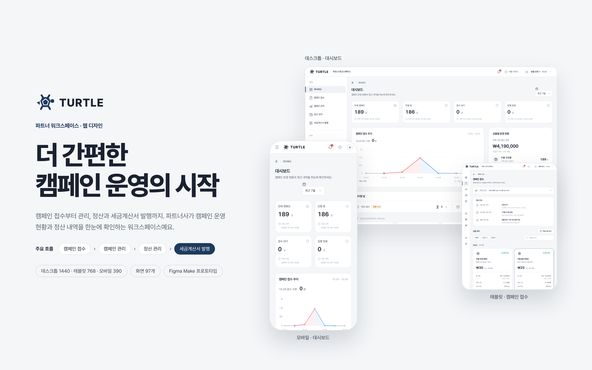

## 프로젝트 개요

| 항목 | 내용 |
| --- | --- |
| 형태 | 반응형 웹 — 데스크톱 1440 · 태블릿 768 · 모바일 390 |
| 주요 흐름 | 캠페인 접수 → 캠페인 관리 → 정산 관리 → 세금계산서 발행 |
| 작업 도구 | Figma Make, Claude 디자인 |
| 화면 수 | 97개 (데스크톱 1440 32개, 태블릿 768 32개, 모바일 390 33개) |
| 디자인 | [@LHW031128](https://github.com/LHW031128) |

## 화면 구성

<details><summary><b>데스크톱 1440</b> — 32개 화면</summary>

- 01 — 로그인 (2)
- 02 — 대시보드 (3)
- 03 — 캠페인 접수 (4)
- 04 — 캠페인 관리 (7)
- 05 — 정산 · 세금계산서 (5)
- 06 — 계정 · 상품 · 공지 (6)
- 07 — 내 정보 · 어드민 · 가이드 (4)
- 08 — 토큰 · 공통 컴포넌트 (1)

</details>

<details><summary><b>태블릿 768</b> — 32개 화면</summary>

- 01 — 로그인 (2)
- 02 — 대시보드 (3)
- 03 — 캠페인 접수 (4)
- 04 — 캠페인 관리 (7)
- 05 — 정산 · 세금계산서 (5)
- 06 — 계정 · 상품 · 공지 (6)
- 07 — 내 정보 · 어드민 · 가이드 (4)
- 08 — 토큰 · 공통 컴포넌트 (1)

</details>

<details><summary><b>모바일 390</b> — 33개 화면</summary>

- 01 — 로그인 (2)
- 02 — 대시보드 (4)
- 03 — 캠페인 접수 (4)
- 04 — 캠페인 관리 (7)
- 05 — 정산 · 세금계산서 (5)
- 06 — 계정 · 상품 · 공지 (6)
- 07 — 내 정보 · 어드민 · 가이드 (4)
- 08 — 토큰 · 공통 컴포넌트 (1)

</details>

## 주요 화면

**대시보드**

[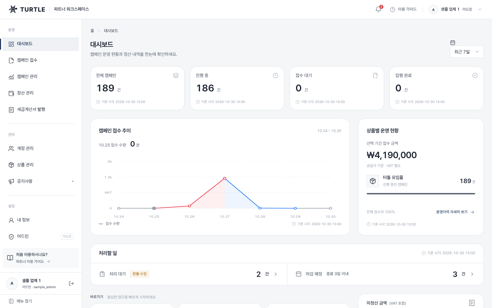](https://lhw031128.github.io/turtle-design/view.html?s=D-Dashboard)

**캠페인 접수**

[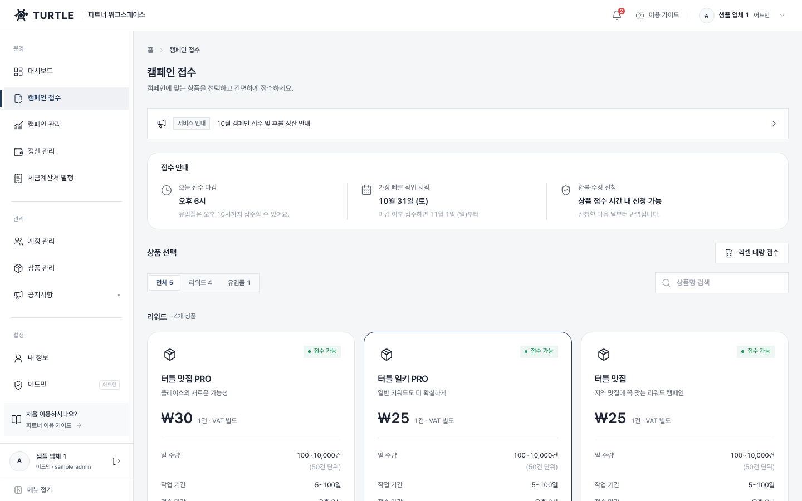](https://lhw031128.github.io/turtle-design/view.html?s=D-Intake)

**캠페인 관리**

[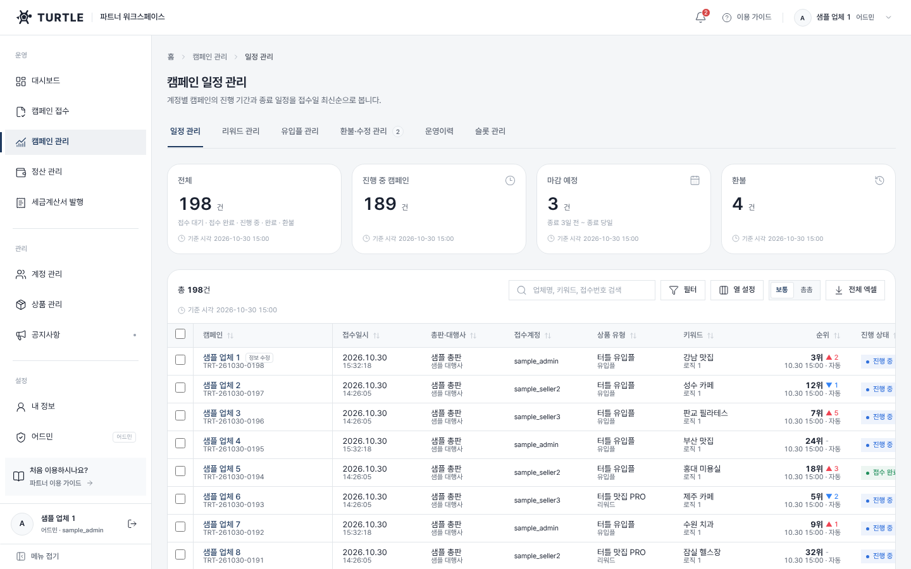](https://lhw031128.github.io/turtle-design/view.html?s=D-Campaigns)

**캠페인 상세 드로어**

[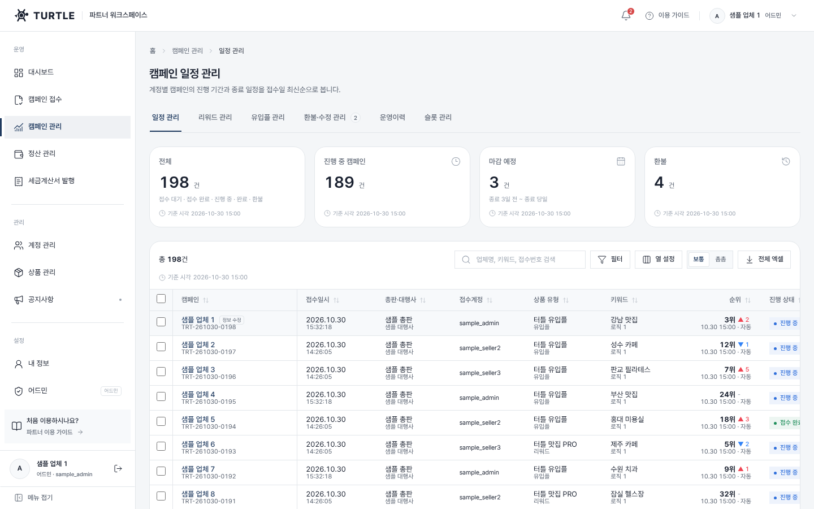](https://lhw031128.github.io/turtle-design/view.html?s=D-Campaigns-Detail)

**정산 관리**

[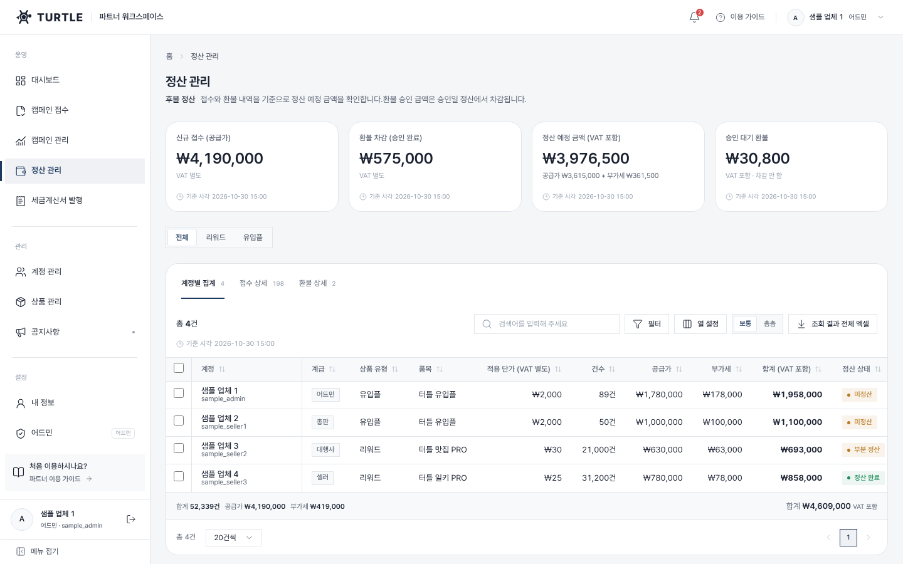](https://lhw031128.github.io/turtle-design/view.html?s=D-Settlements)

**토큰 · 공통 컴포넌트**

[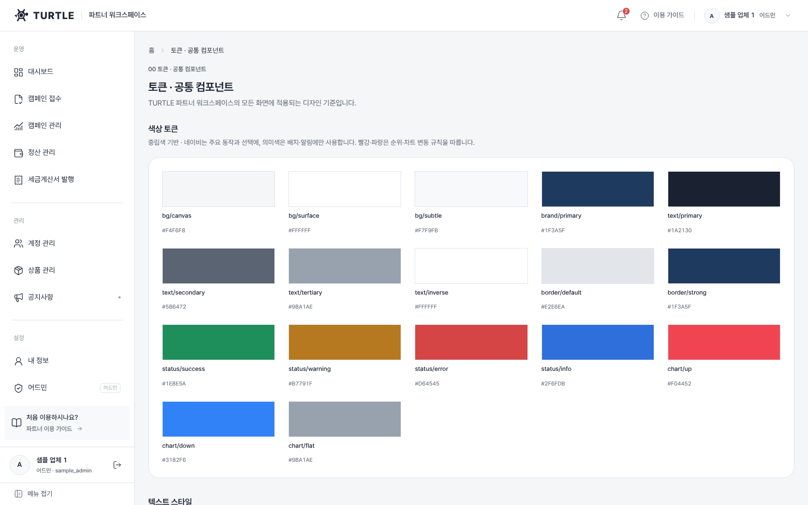](https://lhw031128.github.io/turtle-design/view.html?s=D-Components)

<table>
<tr><td align="center" valign="top"><a href="https://lhw031128.github.io/turtle-design/view.html?s=T-Dashboard">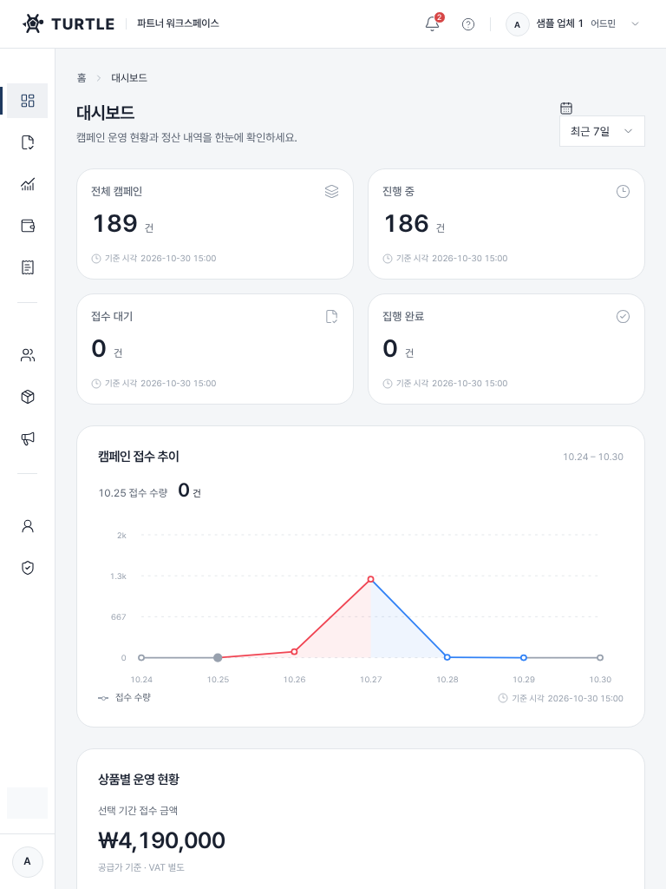</a><br><sub>태블릿 · 대시보드</sub></td><td align="center" valign="top"><a href="https://lhw031128.github.io/turtle-design/view.html?s=T-Intake">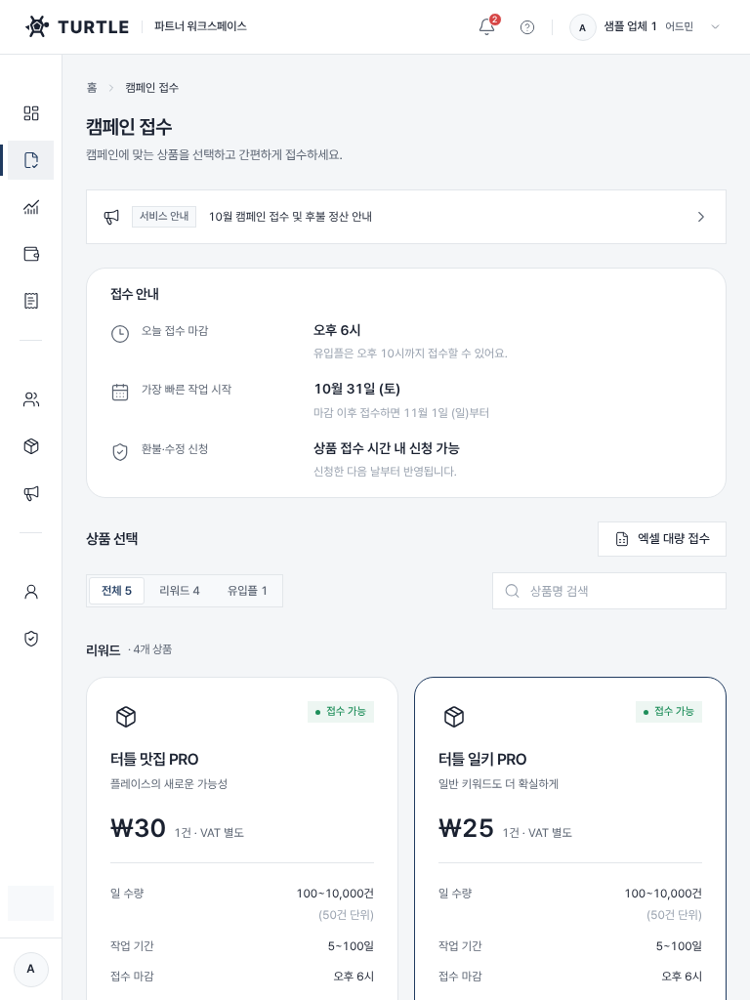</a><br><sub>태블릿 · 캠페인 접수</sub></td></tr>
</table>

<table>
<tr><td align="center" valign="top"><a href="https://lhw031128.github.io/turtle-design/view.html?s=M-Dashboard">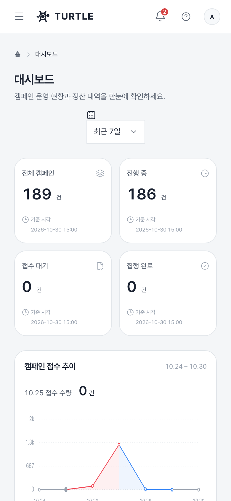</a><br><sub>모바일 · 대시보드</sub></td><td align="center" valign="top"><a href="https://lhw031128.github.io/turtle-design/view.html?s=M-Campaigns">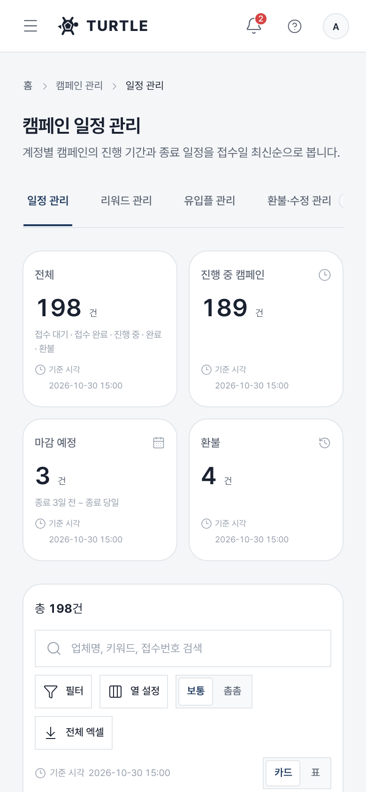</a><br><sub>모바일 · 캠페인 관리</sub></td><td align="center" valign="top"><a href="https://lhw031128.github.io/turtle-design/view.html?s=M-Nav-Drawer">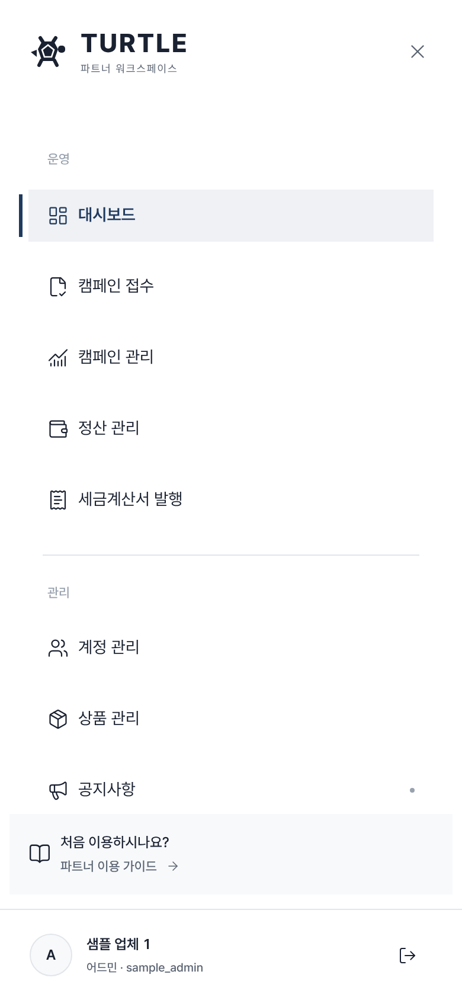</a><br><sub>모바일 · 메뉴 드로어</sub></td></tr>
</table>

## 둘러보는 방법

- **[프로토타입 사이트](https://lhw031128.github.io/turtle-design/)** 에서 그룹별 전체 화면을 볼 수 있어요. 화면을 누르면 실제 크기로 열리고, 화면 안의 버튼 · 메뉴 · 탭을 누르면 연결된 화면으로 이동해요.
- 뷰어에서 키보드 ← → 로 화면을 순서대로 넘겨 볼 수 있어요.

## 폴더 구조

```
index.html        화면 갤러리 (GitHub Pages 첫 화면)
view.html         화면 뷰어 (프로토타입 링크로 화면 이동)
screens/          화면별 HTML
assets/           폰트 · 이미지 · 썸네일
docs/             README 이미지
```

## 참고

- 화면에 나오는 업체명 · 이름 · 연락처 · 금액은 모두 예시 데이터예요.
- 폰트: [Pretendard](https://github.com/orioncactus/pretendard) (SIL Open Font License 1.1) — `assets/fonts/Pretendard-LICENSE.txt`
